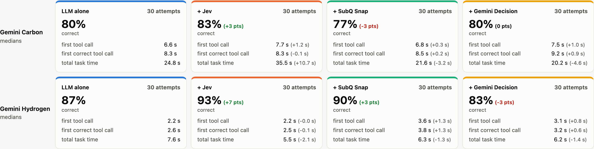
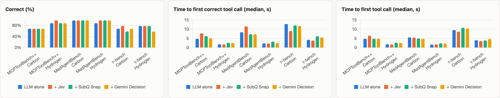

# jevbench: LLM alone vs LLM + decision model

Does putting a decision model in front of an agent LLM make tool use faster, cheaper or more accurate?
One command runs every combination on three existing agent benchmarks and streams the results to a live dashboard.

|  | LLM alone | + Jev | + SubQ Snap | + Gemini Decision |
|---|---|---|---|---|
| **Gemini 4 Carbon** | ✓ | ✓ | ✓ | ✓ |
| **Gemini 4 Hydrogen** | ✓ | ✓ | ✓ | ✓ |

Each cell runs on:

| Benchmark | Industry | What gets scored | Small vs large tool surface |
|---|---|---|---|
| [τ-bench](https://github.com/sierra-research/tau2-bench) (Sierra) | airline, retail, telecom customer service | τ's own reward (final DB state and facts communicated), simulated user | domain tools (13–16) vs 100 |
| [MedAgentBench](https://github.com/stanfordmlgroup/MedAgentBench) (Stanford) | healthcare (FHIR EHR) | Stanford's `refsol.py` grader | 9 FHIR tools + finish vs 100 |
| [MCPToolBench++](https://github.com/mcp-tool-bench/MCPToolBenchPP) | browser, files, search, maps, finance, payments | the benchmark's AST check (exact match, then its LLM-judge prompt) | the item's own tools vs all 87 |

## Why we built this

Agents get slower and less reliable as their tool lists grow: every extra tool is more input tokens and one more way to pick wrong.
"System 1" decision models (Jev, SubQ Snap) claim to fix this by shortlisting the right tools in milliseconds, before the big LLM starts reasoning.
We wanted to test that claim on third-party benchmarks with their own graders, not on a demo we wrote ourselves.

**What we optimize for:** the wait a user actually feels. That is the time until the agent takes the *right* action (`ttfctc_s`, below), without losing accuracy to get it.
A decision model only counts as a win if its own latency is paid back by a faster or more accurate agent.

## Results

Numbers below are from one finished run: 240 task attempts (5 problems × 3 benchmarks × 2 tool lists × 2 Gemini models × 4 setups), medians, 30 attempts per model/setup cell. Full tables in [SMOKE_RESULTS.md](SMOKE_RESULTS.md).
It is a small sample: treat gaps of a few points as noise, and the larger gaps below as the signal.



| Setup (both models, both tool lists) | Correct | Decision model time (p50) | First correct tool call (p50 / p95) |
|---|---|---|---|
| LLM alone | 83% | n/a | 4.6 s / 41.9 s |
| + **Jev** | **88%** | **145 ms** | **4.3 s** / 32.2 s |
| + SubQ Snap | 83% | 469 ms | 5.0 s / 33.8 s |
| + Gemini Decision | 82% | 437 ms | 4.6 s / **29.4 s** |

- **Jev is the quickest decision model and the most accurate setup.** Its decision step takes about a third of the time of SubQ or Gemini Decision, and it is the only setup that clearly beats the LLM alone on correctness (+5 pts overall, +7 on Hydrogen).
- **Jev's gain shows up in the tail.** The median time to the first correct call barely moves, but τ-bench on Carbon drops from 13.0 s to 9.3 s, and p95 drops by about 10 s.
- **Gemini Decision cuts the tail but not the error rate.** It has the best p95, yet its accuracy matches or trails the LLM alone (80% vs 80% on Carbon, 83% vs 87% on Hydrogen).
- **Carbon is the slower model.** Alone, its first correct call takes 8.3 s against 2.6 s for Hydrogen, and a whole task takes 24.8 s against 7.6 s, with 80% vs 87% correct.
- **All three decision models kept the right tool in the shortlist about 97% of the time** while cutting the list to roughly 3 to 8 tools.



Every decision model is compared against the same task, model and tool list run without one, so a setup can't look fast by failing early.
The live dashboard (`python -m jevbench dashboard`) renders these same views and updates while a run is in progress.

## How a "+ decision model" episode works

```
user request ─► decision model: one `choice` question over every tool ──► probabilities
                └─ keep tools until 95% of the probability mass (min 3, max 8)
                   + tools already used + `request_more_tools` escape hatch
             ─► same Gemini agent loop, but only the shortlist is attached
```

Everything except the decision model stays fixed: prompt, tools, thinking level, user simulator, judges, step limits.
On τ-bench the decision model runs again on every new user message.
Jev, SubQ and Gemini Decision get identical questions and the same shortlist rule (`jevbench/router.py`).

## Time to first tool call vs time to first *correct* tool call

Both are measured on the **agent clock**, which runs only while the decision model or the agent LLM is working. Tool execution, the τ user simulator and the judges are excluded, so every setup is timed the same way.

| | `ttftc_s` (time to first tool call) | `ttfctc_s` (time to first *correct* tool call) |
|---|---|---|
| Stops when | the first function-call chunk streams in from Gemini, right or wrong | the first call the benchmark's answer key accepts |
| Tells you | how fast the agent commits to an action | how long a user waits for the right action |
| Weakness | a fast wrong call looks good | none: a wrong call keeps the clock running |

Episodes keep going after a wrong call until a correct one lands (or the step limit hits), so `ttfctc_s` includes the cost of every wasted call. That is why it is the metric we optimize: a decision model that shaves the first call but sends the agent down a wrong path scores worse, not better.
A "+ decision model" episode's clock includes the decision call, so its overhead is charged against it. Each provider gets one discarded warm-up call first, and `python -m jevbench probe` measures the network floor so decision overhead can be read net of latency.

## Metrics (per episode, then p50/p95 per cell)

The **agent clock** only runs while the decision model or the agent LLM is working. Tool execution, the τ user simulator and judges are left out.

| Metric | Meaning |
|---|---|
| `ttftc_s` | time to first tool call: agent clock until the first function-call chunk streams in, right or wrong |
| `ttfctc_s` | time to first *correct* tool call: until the first call the benchmark's answer key accepts |
| `agent_time_s`, `wall_time_s` | whole episode on the agent clock, and real time |
| `decision_time_s`, `first_byte_s` | time spent in the decision model; LLM time to first streamed chunk |
| `score` / `success` | the benchmark's own grade, so a fast answer that is wrong still counts as wrong |
| `calls_before_correct`, `wrong_calls`, `distractor_calls` | wasted calls |
| `shortlist_recall`, `avg_shortlist_size`, `hatch_used` | whether the decision model kept the right tool |
| tokens, `cost_usd` | input/output/cached tokens and USD (prices in `config/matrix.yaml`) |

The dashboard's Δ columns compare each decision model with **the same task / LLM / surface / rep run without one**, over pairs where both made a correct call. A condition can't look fast just by failing early.

What counts as a "correct call":

- **τ:** matches one of the task's expected actions, using τ's own `compare_with_tool_call`.
- **MCPToolBench++:** matches the labelled call (or one of its `similar_tools`).
- **MedAgentBench** has no per-call key, so `EXPECTED` in `jevbench/benches/medagentbench.py` is our annotation of the first call each task type needs. Task success still comes only from `refsol.py`.

## Hosting: everything on one DigitalOcean droplet

None of these models can be self-hosted: Gemini, Jev and SubQ Snap are vendor APIs, and DigitalOcean doesn't serve them.
"Local" therefore means running the runner close to the APIs and measuring the network on its own:

```
DigitalOcean droplet, SFO3 (s-4vcpu-8gb)
  docker compose:
    fhir       MedAgentBench FHIR server (jyxsu6/medagentbench)
    dashboard  FastAPI on :8000, reads Tiger Data
    runner     python -m jevbench run   ──► Gemini API (Carbon, Hydrogen, Decision 1)
                                          ──► api.typesafe.ai (Jev; or OpenRouter)
                                          ──► api.subq.ai (SubQ Snap)
  ──► Tiger Data (Tiger Cloud, Postgres + TimescaleDB): runs, episodes, events hypertable
  ──► Sentry: one transaction per episode, spans per decision / LLM / tool call
```

Run `python -m jevbench probe` on the droplet first. It measures the TLS handshake and warm-call latency to each provider, so you can subtract the network floor from decision overhead. The runner also makes one discarded warm-up call per provider before measuring.

## Setup

### 1. Keys (`cp .env.example .env`)

| Variable | Needed for | Where to get it |
|---|---|---|
| `GEMINI_API_KEY` | **required.** Carbon, Hydrogen, Gemini Decision, the τ user simulator and judges | aistudio.google.com/apikey (paid project: Carbon has no free tier) |
| `TYPESAFE_API_KEY` *or* `OPENROUTER_API_KEY` | **required for Jev**: TypeSafe direct (`api.typesafe.ai`, model `jev-1.14.0`) is used when only the TypeSafe key is set | docs.typesafe.ai / openrouter.ai/keys |
| `SUBQ_API_KEY` | **required for SubQ Snap** | docs.subq.ai |
| `DATABASE_URL` | dashboard storage (Tiger Data) | Tiger console → service → Connect |
| `SENTRY_DSN` | tracing (Sentry raffle) | Sentry → Project Settings → Client Keys |
| `JEV_BASE_URL`, `JEV_MODEL` | optional overrides for the TypeSafe direct route | |
| `OPENAI_API_KEY` | optional: only if you set `tau.judge_llm: null` to keep τ's OpenAI judges | platform.openai.com |
| `DIGITALOCEAN_API_TOKEN` | deploy scripts, doctl, DigitalOcean MCP | DO console → API |
| `DASHBOARD_PASSWORD` | optional basic auth on the dashboard (user `jev`) | you choose |

### 2. MedAgentBench grader

Download `refsol.py` from the link in the MedAgentBench README into `refsol/refsol.py` (it's gitignored).
Without it, MedAgentBench episodes still run and are timed, but their score is null.

### 3. Run it on DigitalOcean

```bash
doctl auth init                                  # uses DIGITALOCEAN_API_TOKEN
scripts/do_create_droplet.sh jevbench            # SFO3, Ubuntu 24.04, Docker via cloud-init
ssh root@<ip>
git clone git@github.com:BaoTNguyen/jev-test.git && cd jev-test
cp .env.example .env && nano .env
mkdir -p refsol && nano refsol/refsol.py
docker compose up -d --build                     # FHIR + dashboard at http://<ip>:8000
docker compose run --rm runner check             # keys + benchmarks + episode plan
docker compose run --rm runner probe             # network floor per provider from SFO3
docker compose run --rm runner run --dry-run     # plan only
docker compose run --rm runner                   # the whole matrix, live on the dashboard
docker compose run --rm runner report            # final table, also written to results/<run>/summary.json
```

Optional: host only the dashboard on App Platform with `doctl apps create --spec deploy/app.yaml`. It reads the same Tiger database.

### Run locally (any OS)

```bash
uv sync --extra dev
scripts/setup_benchmarks.sh        # fetches the 3 benchmarks at pinned commits into vendor/ and installs tau2
docker run -d -p 8080:8080 jyxsu6/medagentbench:latest   # FHIR server for MedAgentBench
export FHIR_API_BASE=http://localhost:8080/fhir/ TAU2_DATA_DIR=$PWD/vendor/tau2-bench/data
export PYTHONUTF8=1                # Windows only: tau reads its data as UTF-8
export VENDOR_DIR=$PWD/vendor      # .env holds the Docker paths; shell values win over .env
# use `uv run --no-sync`: a plain `uv run` re-syncs to uv.lock and uninstalls the editable tau2
uv run --no-sync pytest -q                                                        # offline tests
uv run --no-sync python -m jevbench --config config/smoke.yaml run --no-warmup    # offline smoke run (mock LLM + mock router)
uv run --no-sync python -m jevbench --config config/live_mini.yaml run            # 40 real episodes, ~$1, every condition
uv run --no-sync python -m jevbench dashboard                                     # http://localhost:8000
```

## Size, time and cost

The defaults plan **1,200 episodes** (τ 240, MedAgentBench 480, MCPToolBench++ 480):

- τ: 3 domains × 5 tasks
- MedAgentBench: 10 task types × 3
- MCPToolBench++: 6 categories × 5

Each task runs on 2 surfaces × 2 LLMs × 4 conditions.

Cost is dominated by τ, because every turn re-sends the policy and tools. Expect very roughly $0.2–0.6 per τ episode on Carbon, and cents for the other two benchmarks.
`BUDGET_USD` (default $150) stops the run cleanly, and `run --resume <run_id>` continues it. Shrink or grow the run with `per_domain`, `per_task_type`, `per_category` and `reps`, or limit benchmarks with `run --only tau,mcptoolbench`.

## Tooling for the build (MCP)

`.mcp.json` registers the hosted **DigitalOcean** MCP server (`https://mcp.digitalocean.com/mcp`) and the **Sentry** MCP server (`https://mcp.sentry.dev/mcp`), both with OAuth.
In Claude Code, run `/mcp` to sign in. Then you can ask it to check the droplet, App Platform logs or Sentry traces.

## Repo map

```
config/matrix.yaml          the experiment: models, decision models, router rule, benchmarks, prices
config/smoke.yaml           offline smoke test (mock LLM + mock decision model)
jevbench/decision.py        Jev / SubQ / Gemini Decision / mock clients (raw HTTP, same timing for all)
jevbench/router.py          probabilities -> shortlist (mass / min_k / max_k, sticky, escape hatch, 2-stage >255 tools)
jevbench/llm.py             streaming Gemini conversation with first-chunk / first-call timestamps
jevbench/episode.py         agent clock + metrics recorder, generic tool loop
jevbench/benches/           tau.py, medagentbench.py, mcptoolbench.py adapters
jevbench/runner.py          plans and runs the whole matrix concurrently; budget guard, hard stop, resume
jevbench/store.py, schema.sql   JSONL + Tiger Data (hypertable `events`, continuous aggregate `call_latency_1m`)
jevbench/dashboard.py, static/index.html   live scoreboard
jevbench/probe.py           network floor + warm-call latency per provider
scripts/, deploy/           benchmark setup, droplet creation, cloud-init, App Platform spec
```

## Credits

The method follows [time-to-first-tool-call](https://github.com/nikhilkulkarni1755/time-to-first-tool-call): streamed timestamps, episodes that keep going until a call is correct, mock execution kept off the clock, loud halts, and resume.

The benchmarks are MIT-licensed by their authors (Sierra Research, Stanford ML Group, mcp-tool-bench). They are fetched at pinned commits, not vendored into this repo.
